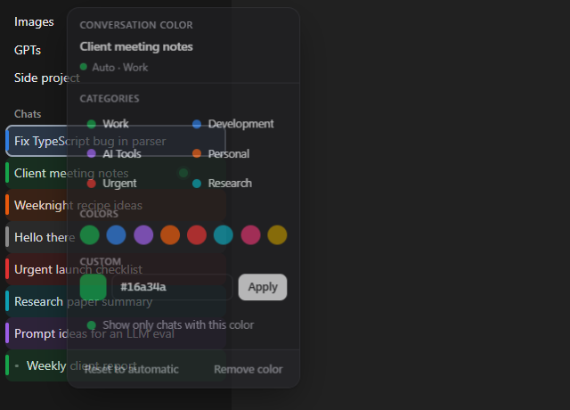
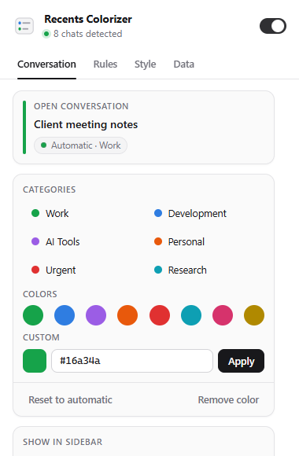
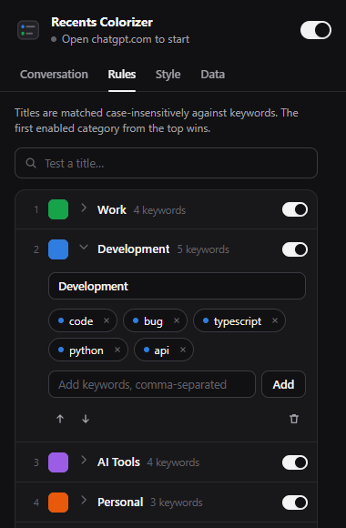

# ChatGPT Recents Colorizer

A small Chrome extension (Manifest V3) that adds colored left borders to conversations in the ChatGPT sidebar. You can set colors by hand or let local keyword rules assign them.

> **Live ChatGPT compatibility: see [QA status](#qa-status).** Automated tests run against fixture pages, not the live site.

| In-page picker (dark) | Popup: conversation | Popup: rules |
|---|---|---|
|  |  |  |

*Screenshots are from the test fixture page with synthetic titles, captured by the Playwright suite. They are not screenshots of chatgpt.com.*

## Features

- **Manual colors per conversation.** Use the small dot that appears on hover or keyboard focus in each sidebar row, or the popup for the open conversation. There are 8+ palette colors, a custom HEX value, *Reset to automatic*, and *Remove color*.
- **Nothing is colored by default.** Out of the box the extension only adds the color control. Chats are colored when you choose a color, or when you add keyword rules.
- **Optional automatic categories.** The starter categories (Work, Development, AI Tools, Personal, Urgent, Research) begin as named colors without keywords. Add your own keywords, or click *Load suggested keywords* on the Rules tab. You can create, rename, delete, recolor and reorder categories. Keywords are case-insensitive and can be toggled one at a time, *Test a title* previews which category matches, and *Uncategorized* can optionally get its own color.
- **Precedence:** a manual color first, then the first matching enabled rule in priority order, then the fallback color.
- **Stable IDs.** Colors are keyed by the conversation UUID from the URL, including Project and custom-GPT chats, so renaming a chat keeps its manual color while automatic colors update.
- **Appearance:** *Bar*, *Fill* (a tinted row background), or *Bar + fill* (the default), with fill strength, bar width, opacity and roundness, plus a live preview and a global on/off switch. The color is drawn by the extension's own overlay elements on the whole row, so there's no layout shift and ChatGPT's row styles are never changed. Respects `prefers-reduced-motion`.
- **Open-chat highlight:** the conversation open in the tab gets a subtle outline that follows you as you switch chats (including Back/Forward) and keeps its own color. It uses ChatGPT's own `aria-current` marker, falling back to the URL. You can turn it off under *Style*.
- **Already open in another tab:** chats that are open in another ChatGPT tab show a small two-window badge. Clicking it switches to that tab, in any window, instead of opening a duplicate. Clicking the row itself still behaves normally. No extra permissions are needed; a background worker tracks only conversation IDs per tab, for the session. You can turn it off under *Style*.
- **Troubleshooting:** the popup's header shows how many chats were detected. *Data → Copy diagnostics* produces a structure-only report (no titles, ids masked) for bug reports.
- **Import/export** settings as JSON, with validation.
- **Private by design:** only the `storage` permission, runs only on `chatgpt.com`, no network requests. See [PRIVACY.md](PRIVACY.md).

## Install (unpacked)

1. Build it, or use an existing `dist/` folder:
   ```sh
   npm ci
   npm run build
   ```
2. Open `chrome://extensions`.
3. Turn on **Developer mode** (toggle, top-right).
4. Click **Load unpacked** and select the `dist` folder. Select `dist` itself, not the project root.
5. Pin the extension (puzzle icon → pin) and reload any open chatgpt.com tabs.

Requires Chrome 114 or later. After rebuilding, click the reload icon on the extension card and refresh ChatGPT.

## Usage

- **Color one chat:** hover a sidebar conversation, or Tab to it, then click the small dot near the right edge and pick a category, a color, or a custom HEX. Clicking the dot never opens the chat.
- **Popup → Conversation:** colors the conversation open in the current tab.
- **Popup → Rules:** expand a category to rename it, add keywords (comma-separated, Enter to add), click a keyword chip to toggle it, or use ↑/↓ to change priority. *Test a title* previews the match. *Uncategorized* sets the fallback color or turns its border off.
- **Popup → Style:** sliders apply live to every open ChatGPT tab.
- **Popup → Data:** JSON export/import (an invalid file is rejected without changing anything), diagnostics, and reset.

**If no colors appear:** the header should read "N chats detected". If it says "Sidebar not recognized", open *Data → Copy diagnostics* and include the report in an issue.

## Privacy

The extension reads only sidebar conversation links and their visible titles. It never reads messages, cookies or credentials, and nothing leaves your browser. Full details are in [PRIVACY.md](PRIVACY.md).

## Known limitations

- ChatGPT is a third-party app whose markup can change at any time. All selectors live in [`src/content/adapter.ts`](src/content/adapter.ts). If they stop matching, the extension does nothing rather than breaking the page.
- Rules match only titles **visible in the sidebar**. Conversations that haven't been loaded by scrolling yet aren't classified until they appear.
- When the sidebar is collapsed (or on mobile layouts), there are no rows to color. The popup still works for the open conversation.
- The in-row control's position is chosen so it clears ChatGPT's own row menu. That offset is tuned for the fixture and may need adjusting on the live site.
- There is no extension icon yet, so Chrome shows a default letter icon.

## Development

```sh
npm ci
npm run check        # lint + typecheck + unit tests + build
npm run test:e2e     # Playwright, loads dist/ into Chromium (run `npx playwright install chromium` once)
```

Read [docs/ARCHITECTURE.md](docs/ARCHITECTURE.md), [docs/TESTING.md](docs/TESTING.md) and [docs/FEASIBILITY.md](docs/FEASIBILITY.md) for more detail.

## Contributing

1. Fork, then make a branch.
2. Keep ChatGPT-DOM knowledge inside `src/content/adapter.ts`. Add or adjust a fixture in `tests/fixtures/` for any DOM change.
3. Don't add runtime dependencies, permissions, network calls, `innerHTML` or `eval`. ESLint blocks the last three.
4. `npm run check` and `npm run test:e2e` must pass. CI runs both.
5. Describe in the PR what you verified on the live site, if anything.

## Releasing

1. Bump `version` in both `package.json` and `public/manifest.json`.
2. Run `npm run check && npm run test:e2e`.
3. Smoke-test the build on live chatgpt.com (load unpacked, color a chat, reload, rename).
4. Zip the **contents** of `dist/`, for example `cd dist && zip -r ../chatgpt-recents-colorizer-<version>.zip .`.
5. Tag `v<version>` and attach the zip to the GitHub release. Chrome Web Store upload is a separate, manual step.

## QA status

See the final QA report in [docs/QA.md](docs/QA.md).

## License

[MIT](LICENSE)
