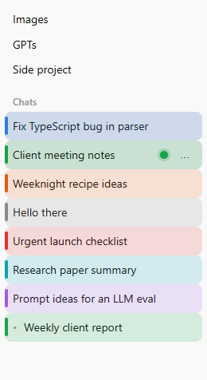
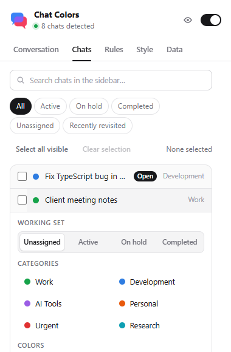
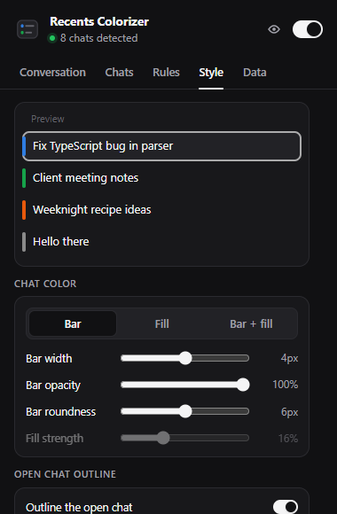

# Chat Colors


Chat Colors is a small Chrome extension (Manifest V3) for ChatGPT that adds colored left borders to conversations in the ChatGPT sidebar. You can set colors by hand or let local keyword rules assign them.

> **Live ChatGPT compatibility: see [QA status](#qa-status).** Automated tests run against fixture pages, not the live site.

| Sidebar (fixture) | Popup: Chats | Popup: Style |
|---|---|---|
|  |  |  |

*Screenshots are from the test fixture page with synthetic titles, captured by the Playwright suite. They are not screenshots of chatgpt.com.*

## Features

- **Manual colors for any conversation, from the popup.** The *Chats* tab lists every chat loaded in the sidebar, open or not, with search. The *Conversation* tab handles the chat that's open. You get the category colors, 8 presets, any custom HEX, *Reset to automatic*, and *Remove color*. Nothing is added to ChatGPT's rows: no buttons and no extra icons, and its three-dot menu is untouched.
- **Nothing is colored by default.** Out of the box the extension only adds the color control. Chats are colored when you choose a color, or when you add keyword rules.
- **Optional automatic categories.** The starter categories (Work, Development, AI Tools, Personal, Urgent, Research) begin as named colors without keywords. Add your own keywords, or click *Load suggested keywords* on the Rules tab. You can create, rename, delete, recolor and reorder categories. Keywords are case-insensitive and can be toggled one at a time, *Test a title* previews which category matches, and *Uncategorized* can optionally get its own color.
- **Precedence:** a manual color first, then the first matching enabled rule in priority order, then the fallback color.
- **Stable IDs.** Colors are keyed by the conversation UUID from the URL, including Project and custom-GPT chats, so renaming a chat keeps its manual color while automatic colors update.
- **Appearance:** *Bar* (the default: a slim left bar, no background), *Fill* (a tinted row background), or *Bar + fill*, with bar width, opacity and roundness and fill strength, plus a live preview and a global on/off switch. The color is drawn by the extension's own overlay elements on the whole row, so there's no layout shift and ChatGPT's row styles are never changed. Respects `prefers-reduced-motion`.
- **Bulk assignment (Chats tab):** search, select chats with checkboxes, *Select all visible*, *Clear selection*, then set a category color, a preset, any HEX, Reset or Remove for all of them at once.
- **Working Set:** mark chats *Active*, *On hold* or *Completed* (or leave them *Unassigned*), one at a time or in bulk. View chats by status in the popup, or filter the ChatGPT sidebar by status (*Conversation → Show in sidebar → By working set*). Statuses never add anything to the sidebar rows.
- **Recently revisited:** a popup view of chats you've opened at least twice, most recent first, with visit count and time. Only conversation IDs and timestamps are stored, on this device only. You can turn it off or clear it under *Data*.
- **Presenter Mode:** hides chat titles in the sidebar (and in the popup) by blurring them or showing dots, while colors, the outline and filters stay visible. Optionally a title shows temporarily on hover or keyboard focus. Toggle it with the eye button in the popup header or the shortcut (default *Alt+Shift+P*, configurable or off), which works while a ChatGPT tab has focus.
- **Open-chat outline:** the conversation open in the tab gets a subtle inset outline that follows you as you switch chats (including Back/Forward) and keeps its own color. Its color (Auto, presets or HEX), width and opacity are configurable and it can be turned off. Windows high-contrast mode uses the system highlight color. It uses ChatGPT's own `aria-current` marker, falling back to the URL.
- **Troubleshooting:** the popup's header shows how many chats were detected. *Data → Copy diagnostics* produces a structure-only report (no titles, ids masked) for bug reports.
- **Import/export** settings as JSON, with validation.
- **Private by design:** only the `storage` permission, runs only on `chatgpt.com`, no network requests. See [PRIVACY.md](PRIVACY.md).

## Install (unpacked)

1. Build it, or use an existing `dist/` folder:
   ```sh
   npm ci
   npm run build
   ```
2. Open `chrome://extensions`.
3. Turn on **Developer mode** (toggle, top-right).
4. Click **Load unpacked** and select the `dist` folder. Select `dist` itself, not the project root.
5. Pin the extension (puzzle icon → pin) and reload any open chatgpt.com tabs.

Requires Chrome 114 or later. After rebuilding, click the reload icon on the extension card and refresh ChatGPT.

## Usage

- **Color any chat:** open the popup, go to *Chats*, search or scroll, click a chat, and pick a category, a preset, or a custom HEX. It works for chats that aren't open. For the open chat, the *Conversation* tab does the same, and inside a Project you can switch between *This chat* and *All in Project*.
- **Open-chat outline:** *Style → Open chat outline*. Turn it on or off, pick *Auto* (the sidebar's text color), a preset or any HEX, and set its width and opacity.
- **Popup → Conversation:** colors the conversation open in the current tab.
- **Popup → Rules:** expand a category to rename it, add keywords (comma-separated, Enter to add), click a keyword chip to toggle it, or use ↑/↓ to change priority. *Test a title* previews the match. *Uncategorized* sets the fallback color or turns its border off.
- **Popup → Style:** sliders apply live to every open ChatGPT tab.
- **Popup → Data:** JSON export/import (an invalid file is rejected without changing anything), diagnostics, and reset.

**If no colors appear:** the header should read "N chats detected". If it says "Sidebar not recognized", open *Data → Copy diagnostics* and include the report in an issue.

## Privacy

The extension reads only sidebar conversation links and their visible titles. It never reads messages, cookies or credentials, and nothing leaves your browser. Full details are in [PRIVACY.md](PRIVACY.md).

## Known limitations

- ChatGPT is a third-party app whose markup can change at any time. All selectors live in [`src/content/adapter.ts`](src/content/adapter.ts). If they stop matching, the extension does nothing rather than breaking the page.
- Rules match only titles **visible in the sidebar**. Conversations that haven't been loaded by scrolling yet aren't classified until they appear.
- When the sidebar is collapsed (or on mobile layouts), there are no rows to color. The popup still works for the open conversation.
- The *Chats* tab, bulk actions and the *Recently revisited* view only cover chats ChatGPT has loaded into the sidebar. Scroll the sidebar to load older ones. Revisited chats that aren't loaded are counted but not listed, because titles are never stored.
- Presenter Mode conceals sidebar rows the extension recognizes. It doesn't hide the conversation title ChatGPT shows in the browser tab or in the page header. The shortcut only works while a ChatGPT tab has focus; a global shortcut would need a background worker, which the extension doesn't have.
- Recently revisited counts visits only while the extension is installed and enabled, per browser profile.
- Colors are set in the popup, not from ChatGPT's own three-dot menu. Adding an item there was judged too fragile without verified access to that menu's markup.
- There is no extension icon yet, so Chrome shows a default letter icon.

## Development

```sh
npm ci
npm run check        # lint + typecheck + unit tests + build
npm run test:e2e     # Playwright, loads dist/ into Chromium (run `npx playwright install chromium` once)
```

Read [docs/ARCHITECTURE.md](docs/ARCHITECTURE.md), [docs/TESTING.md](docs/TESTING.md) and [docs/FEASIBILITY.md](docs/FEASIBILITY.md) for more detail.

## Contributing

1. Fork, then make a branch.
2. Keep ChatGPT-DOM knowledge inside `src/content/adapter.ts`. Add or adjust a fixture in `tests/fixtures/` for any DOM change.
3. Don't add runtime dependencies, permissions, network calls, `innerHTML` or `eval`. ESLint blocks the last three.
4. `npm run check` and `npm run test:e2e` must pass. CI runs both.
5. Describe in the PR what you verified on the live site, if anything.

## Releasing

1. Bump `version` in both `package.json` and `public/manifest.json`.
2. Run `npm run check && npm run test:e2e`.
3. Smoke-test the build on live chatgpt.com (load unpacked, color a chat, reload, rename).
4. Zip the **contents** of `dist/`, for example `cd dist && zip -r ../chat-colors-<version>.zip .`.
5. Tag `v<version>` and attach the zip to the GitHub release. Chrome Web Store upload is a separate, manual step.

## QA status

See the final QA report in [docs/QA.md](docs/QA.md).

## License

[MIT](LICENSE)
